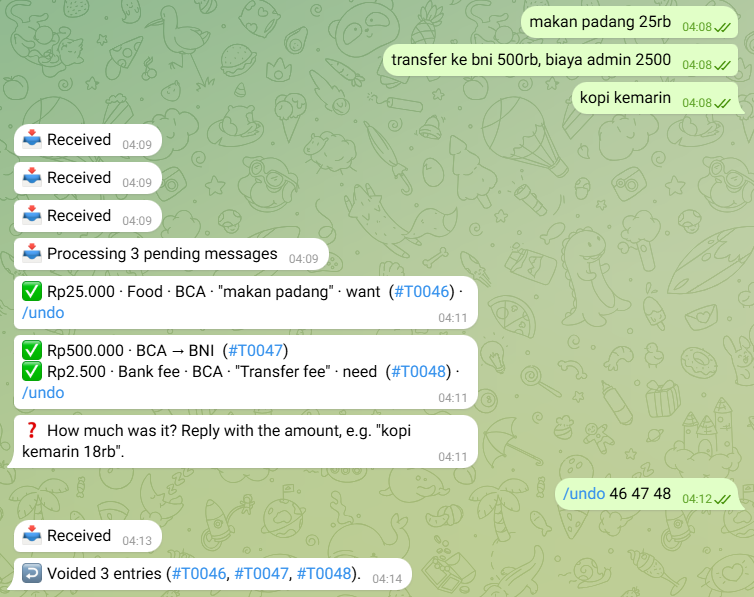

# AI Expense Logger (Telegram + n8n + Google Sheets)

Send a chat message, a receipt photo or a bank screenshot to a Telegram bot. An LLM turns it into structured transactions, code checks the result against business rules, and the rows land in a Google Sheet ledger. The bot replies with a confirmation that can be undone.



I built it to replace manual entry in a money app, and run it every day for my own ledger. The data in this repository (categories, accounts, fixtures) is sample data.

## How it works

```
Telegram bot <--getUpdates, 1 min-- Google Apps Script (always on, free)
                              |  append the raw update to the "Inbox" tab, reply "Received"
                              v
                     Google Sheet (ledger + master data)
                              ^
                              |  every minute: read Inbox rows with status=new
                     n8n (self-hosted, can be offline)
                              |-- LLM call: text or image -> JSON (structured output)
                              |-- Code nodes: validation, business rules, dedupe
                              |-- Sheets: write Transactions, update Inbox status
                              '-- Telegram: result reply
```

Two parts with different jobs:

- **Capture never sleeps.** A Google Apps Script trigger polls Telegram every minute and stores the raw message. It does not parse anything.
- **Processing can be off.** n8n runs on a laptop. Messages sent while it is off wait in `Inbox` and are processed in order when it comes back, with one notice (`📥 Processing 3 pending messages`).

## What it does

- Free text in Indonesian or English (`gojek 15rb bni`, `kopi kemarin 18rb`, `transfer ke koperasi 2jt, biaya admin 2500`), receipt photos, and bank or e-wallet screenshots.
- Expense, income and transfer entries. A stated transfer fee becomes its own `Bank fee` row.
- Categories with groups and aliases, a need/want field, and an `irregular` flag for yearly items, all kept as master data in the Sheet.
- Low-confidence entries are saved as `needs_review` and marked `⚠️`; `/review` lists them and `/ok` confirms them.
- A daily 21:00 nudge with the number of entries logged that day, which also shows the system is alive.
- A monthly summary sent on the 1st at 08:00.
- Recurring rules kept in a `Recurring` tab (weekly, monthly or yearly): `auto` rules write the entry on the due date, `reminder` rules only send a message, and dates missed while n8n was off are caught up.
- Bank statement import: a screenshot of a transaction list becomes one entry per row, and rows already in the ledger are skipped (`4 rows: 2 already logged, 2 added`).
- Receipt split: caption a receipt with `items 2 and 3` and only your share is saved, including its part of tax, service and discount.

| Command | What it does |
| --- | --- |
| `/undo`, `/undo 25` | Void the last entry, or one by id. Rows are never deleted. |
| `/last`, `/last 10` | Show the latest entries. |
| `/review`, `/ok`, `/ok 16 25` | List and confirm entries that need review. |
| `/summary`, `/summary 2026-10` | A month in numbers: totals by group, need vs want, irregular items, runway. |
| `/recurring` | Active recurring rules and when each is next due. |
| `/balance` | Account balances and the liquid total. |
| `/cash 150000` | Set real cash; the difference is logged as unrecorded cash. |

## Design choices

**The LLM extracts, code decides.** The model returns JSON through a strict schema. Everything that must be right is then checked or computed in plain JavaScript (`n8n/code/validate.js`): which account a text message names, date resolution, fee rows, missing fields, amounts. Totals and balances are never computed by the model.

**Guards come from failures, not guesses.** Each of these was seen in a test run or in live use and then fixed in code:

- For `kopi kemarin` (no amount) the model invented Rp25.000 with confidence 1. A text message without a digit or an amount word now gets a question back instead of a row.
- The model put entries on the wrong account in both directions. For text messages the account is now decided from the text.
- A fee returned twice (as `fee` and as its own expense) is written once.
- A date without a year came back as 2023. The year is now resolved in code from the message time.
- Asked for "items 2 and 3" of a receipt, the model listed only those two lines, so nothing looked like a split and the whole bill was saved. The share is computed in code from the printed subtotal, and that case is flagged for review.
- n8n reruns a node with "retry on fail" when its output has an `error` field, even an empty one. A queue row was appended three times and every Inbox update took 15 s instead of 1 s, until retry was removed from those nodes.
- A long scrolling screenshot is shrunk by Telegram until it is unreadable, and the model made up rows. Photos with a height to width ratio above 5 are refused before the LLM call.

**Nothing is lost quietly.** Every message gets a row in `Inbox` with a status (`new`, `processing`, `done`, `error`). A failed LLM call marks the row `error` and sends a `🔴` reply; later messages still go through. A row stuck in `processing` for 30 minutes is retried, and the retry checks for rows already written, so nothing is saved twice.

**Testable outside n8n.** The logic lives in plain JavaScript files with no n8n globals, unit-tested with `node --test`. `n8n/build.js` inlines them into the workflow templates, so the workflow JSON in `n8n/dist` is generated, not hand-edited. A test also fails the build if an export contains anything that looks like a key, a token, a Sheet id or a chat id.

**Secrets stay in the stores.** The bot token, the LLM key and the Google login live in the n8n credential store and in Apps Script Script Properties. Only one Telegram chat id is allowed in; any other sender is ignored.

## Tests

```
npm test
```

126 tests, no network. `fixtures/text.json` holds 20 text messages with their expected rows; they can be run against the real model (`fixtures/run.js`, or `fixtures/n8n-runner.js` to use the credential stored in n8n). With the guards above, `gpt-4o-mini` passes 20 of 20.

## Layout

```
apps-script/Code.gs      capture: pollUpdates (1-minute trigger), setup(), installPolling()
data/seed.json           sample categories, accounts, a recurring rule, state
n8n/code/*.js            pure logic, unit tested
n8n/workflows/*.json     workflow templates; Code nodes pull in the logic files
n8n/build.js             templates -> n8n/dist/*.json (import these)
n8n/dist/*.json          six workflows: Process Inbox, Parse Entry, Commands, Nudge, Monthly summary, Recurring
fixtures/                text fixtures and their runners
test/                    node --test
docs/SETUP.md            setup steps
```

## Run it yourself

You need a Telegram bot, a Google account, an OpenAI API key and n8n 2.45 or later (Node 24). The steps are in [docs/SETUP.md](docs/SETUP.md). The repository has no npm dependencies.

## Known limits

- Single user: one allowed chat, one Sheet.
- Replies take about one to two minutes, because both capture and processing poll every minute.
- No edit by chat yet: fix a row in the Sheet, or `/undo <id>` and send it again.
- A Telegram reply can still be lost or sent twice when the network is very slow; the ledger row itself is written once.
- Receipt split and statement import are checked with unit tests and rendered sample images; real statements and receipts in volume have not been measured.
- Downloading a photo from Telegram inside n8n has no timeout; a stuck download holds the queue until the run is stopped or the 30-minute stale window passes.
- Tested with synthetic receipts and real bank screenshots; a wide set of real paper receipts has not been measured.

## License

MIT, see [LICENSE](LICENSE).
